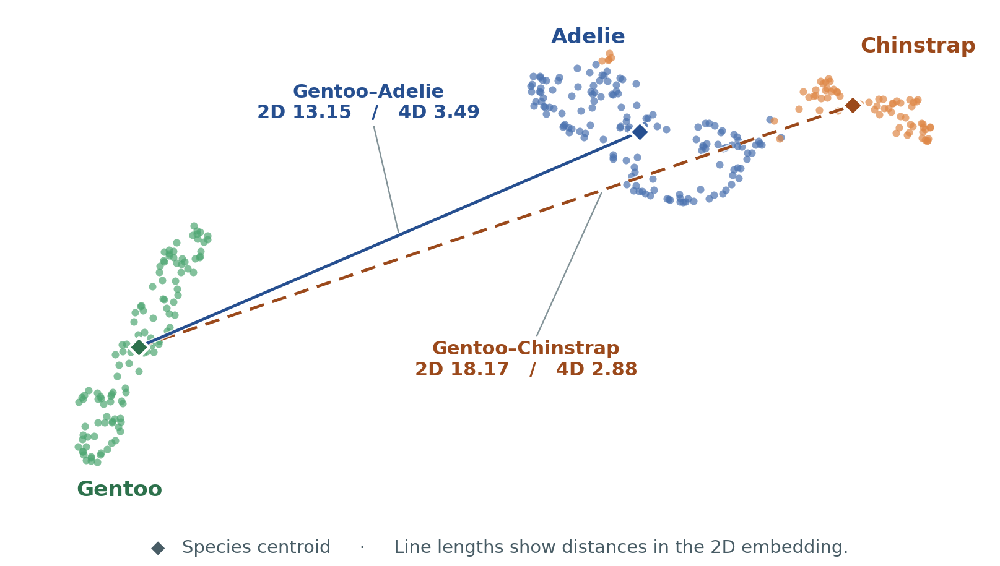
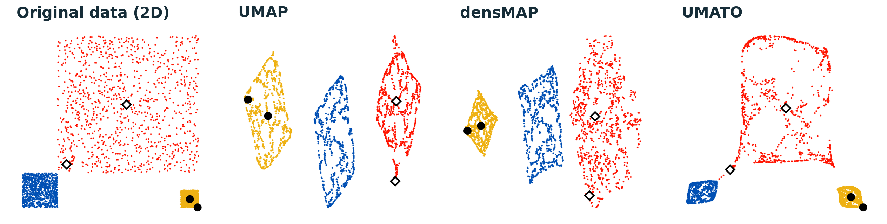
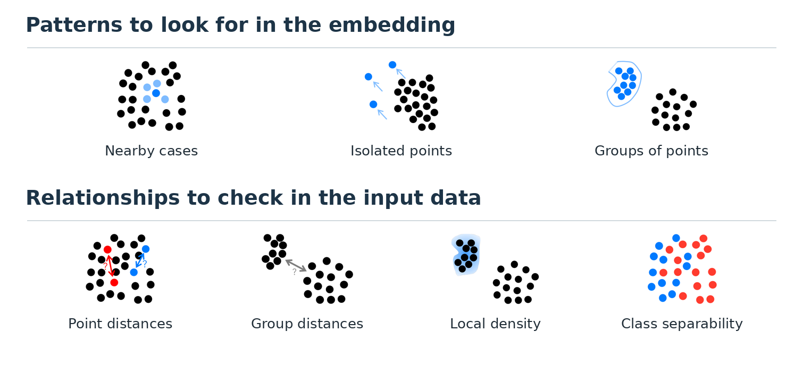

.. _interpreting_embeddings:

Interpreting UMAP embeddings
============================

In :doc:`basic_usage`, we plotted penguins using four body measurements
and colored each point by species. Let's look at those penguins again.
The green Gentoo points form a group of their own. Looking across the
plot from that group, which species seems closer to Gentoo?

   Each dot is a penguin. Each diamond is the mean position of one
   species in this embedding. The lines connect the Gentoo centroid to
   the other two centroids. This is a new, fixed-seed layout of the
   same 333 penguins used in the tutorial.

Two questions about the green group
-----------------------------------

**Do Gentoo penguins have similar neighbors?** For each Gentoo penguin,
we found the 15 nearest *other* penguins using standardized bill length,
bill depth, flipper length and body mass. For all 119 Gentoo penguins,
all 15 neighbors were Gentoo. The green group corresponds to a pattern
that we can also find in the original measurements.

**Which species is closer to the average Gentoo?** Follow the solid
line and then the dashed line. In the plot, the Adelie centroid is
closer to Gentoo (13.15 versus 18.17). In the four measurements, the
Chinstrap centroid is closer (2.88 versus 3.49).

.. list-table:: Euclidean distances between species centroids
   :header-rows: 1
   :widths: 42 29 29

   * - Species pair
     - UMAP layout (2D)
     - Body measurements (4D)
   * - Gentoo and Adelie
     - **13.15**
     - 3.49
   * - Gentoo and Chinstrap
     - 18.17
     - **2.88**
   * - Adelie and Chinstrap
     - 5.18
     - 1.88

In each space we averaged every coordinate separately within each
species, then measured the distance between the two means. The four
measurements were standardized across all 333 penguins before taking
species means. Compare the ordering *within* each column. The two
columns use different units.

You can check the table with the
:download:`coordinates and standardized measurements <data/interpretation_penguins.csv>`.
The 2D coordinates come from ``umap-js`` 1.4.0 with 15 neighbors,
``minDist=0.1`` and ``seedrandom('42')``. Species labels were used only
for coloring and for checking the result. Other runs can produce
different 2D distances.

What happens if the data are already two-dimensional?
-----------------------------------------------------

This time we can see the original data directly. Each point starts with
two coordinates. The left panel plots those coordinates as they are.
The other three panels take the **same two-dimensional input** and lay
it out again in two dimensions.

   Colors and black symbols track the same observations across panels.

Follow the yellow group from the original data to **UMAP**. You can
still pick it out, but it stretches into a long shape. The two black
dots that almost touch in the original now sit farther apart.

In **densMAP**, yellow is compact again while red occupies more space.
Now follow the blue group. It still sits between yellow and red in the
layout. Recovering a visible density difference and recovering the
arrangement of three groups are two different questions.

In **UMATO**, the blue and yellow groups are small and lie on opposite
sides below the red group, much as they did in the input. Compare how
the groups are positioned relative to one another. Rotating the entire
drawing would leave those relationships intact.

Why do these differences arise?
-------------------------------

UMAP focuses on neighbors
~~~~~~~~~~~~~~~~~~~~~~~~~

UMAP tries to place observations that are neighbors in the input close
together in the embedding. If two points have no direct neighborhood
connection, they can end up far apart even when their original distance
was fairly small. Groups can therefore remain recognizable while the
gaps between them change. See :doc:`how_umap_works`.

When relative density matters
~~~~~~~~~~~~~~~~~~~~~~~~~~~~~

densMAP also takes into account how far each point had to reach to find
its neighbors in the input. It encourages neighborhoods that were
relatively tight in the data to stay relatively tight in the plot.
This helps when you want to explore where similar observations are
concentrated. In the four-panel example you can see the small yellow
group again, even though the gaps between groups have changed.

**densMAP is available in this library.** To try it on the same
standardized feature matrix, pass ``densmap=True`` to the constructor.
The :doc:`densmap_demo` tutorial has a worked example.

.. code-block:: python

   import umap

   embedding = umap.UMAP(densmap=True, random_state=42).fit_transform(X)

When the arrangement of several groups matters
~~~~~~~~~~~~~~~~~~~~~~~~~~~~~~~~~~~~~~~~~~~~~~

UMATO starts by choosing representative points, called hubs. It takes
all pairs of hubs into account when arranging them, so representatives
from distant regions influence the layout early on. It then places the
remaining observations and refines their neighborhoods around that
arrangement.

This makes UMATO worth comparing when you want to see individual groups
and explore how several groups are positioned relative to one another.
Some immediate neighbors can change as the broader arrangement improves.
For a conclusion about which species is closest to Gentoo, you can
check the relevant centroid distances directly, as above. UMATO is
available in the separate `umato package <https://github.com/hyungkwonko/umato>`_.

What can I read from my own UMAP plot?
--------------------------------------

Pick a single penguin and you might ask which other birds resemble it.
Step back and the space between the colored groups might make you wonder
which species resemble each other. Start with the question
you are trying to answer.

   The first row helps you select observations to examine together.
   The second asks how those observations relate in the input data.

Patterns to look for in the embedding
~~~~~~~~~~~~~~~~~~~~~~~~~~~~~~~~~~~~~

**Which cases resemble this one?** Select a penguin and inspect the
records for several nearby dots. Do they have similar bills, similar
body masses, or both? If the identity of a particular neighbor matters,
list the closest observations in the original four features and check
whether that individual appears. Finding that all 15 neighbors are
Gentoo establishes the species of the neighbors. It leaves open whether
the *same 15 individuals* are neighbors in the plot.

**What makes this isolated point worth a look?** Suppose an orange
Chinstrap dot sits next to a blue Adelie group. Compare its measurements
with those of other Chinstraps. One feature might be unusual, or a rare
combination might be made up of individually common values. If you find
many similar Chinstraps in the input, describe the point as isolated
in this view. Calling it an outlier in the data would require further
evidence.

**What do the points in this group share?** Select several points
from the middle and several from the edge of an island. Does the common
feature you found in the middle extend to the edge? Compare observations
on opposite sides of a visible gap. If many are neighbors in the input,
a continuous change may have appeared as a split. Counting the islands
would then give a misleading count of groups.

Relationships to check in the input data
~~~~~~~~~~~~~~~~~~~~~~~~~~~~~~~~~~~~~~~~

**How different are two observations?** Suppose the line from A to B
looks twice as long as the line from A to C. To check the ordering or
the ratio, calculate both distances using the same input features,
scaling and metric. Then inspect individual features if you want to
explain the difference. Check how much bill length and body mass each contributed.

**Which groups are most similar?** In the penguin example the question
concerned the *average* member of each species, so we compared their
centroids in the four measurements. Two groups can have nearby centroids
even when individual members differ widely. If you care how different
a typical cross-group pair is, take one observation from each group and
examine the distribution of distances across such pairs.

**Which group is denser?** Recall how the small yellow group spread out
in UMAP. To compare local crowding in your own data, find the distance
from each observation to its tenth nearest other observation in the
input. With the same features, metric and neighborhood size, a smaller
radius means more observations fit nearby. If you want to know which
group contains more observations, count the records. A large sample and
a tightly packed neighborhood answer different questions.

**How well do known classes separate?** Select points where two colors
meet and inspect whether their input-space neighbors have mixed labels
too. In the penguin example, labels were added after fitting. If labels
were used to fit a :doc:`supervised embedding <supervised>`, their
separation in the plot also reflects that supervision. If the question
is whether you can predict the species of a new bird, split the data
before fitting the pipeline and evaluate predictions on held-out birds.

Further reading
---------------

* Hyeon Jeon, Jeongin Park, Sungbok Shin and Jinwook Seo (2026).
  `Stop Misusing t-SNE and UMAP for Visual Analytics <https://arxiv.org/abs/2506.08725v3>`_.
  The four-panel comparison and the task illustrations are adapted from
  Figures 1 and 2.
* Dylan Cashman, Mark Keller, Hyeon Jeon, Bum Chul Kwon and Qianwen
  Wang (2025). `A Critical Analysis of the Usage of Dimensionality
  Reduction in Four Domains <https://doi.org/10.1109/TVCG.2025.3567989>`_.
  IEEE Transactions on Visualization and Computer Graphics, 31(10),
  9405–9423.
