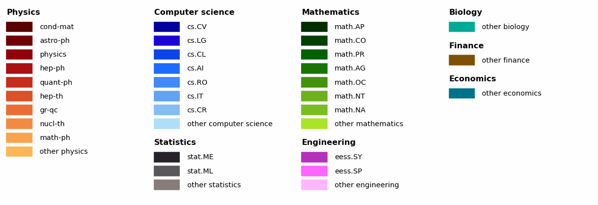
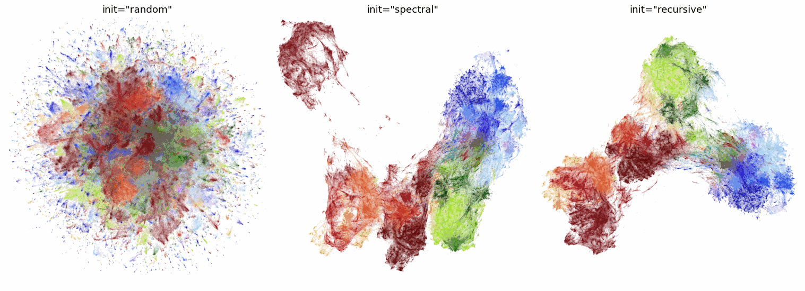
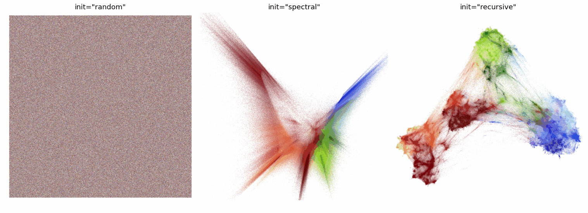
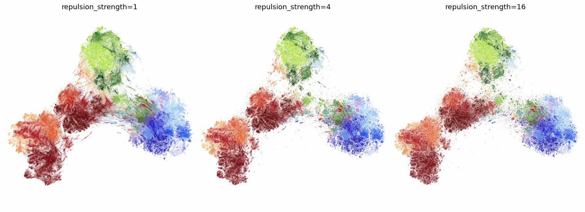
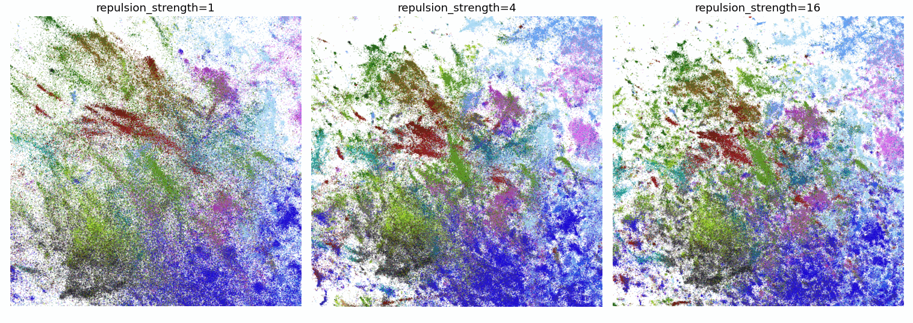
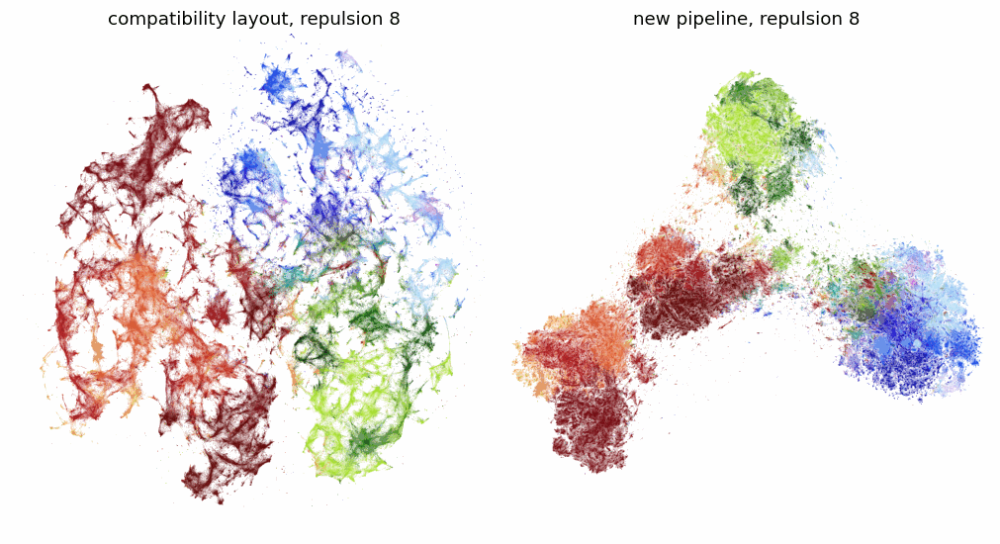
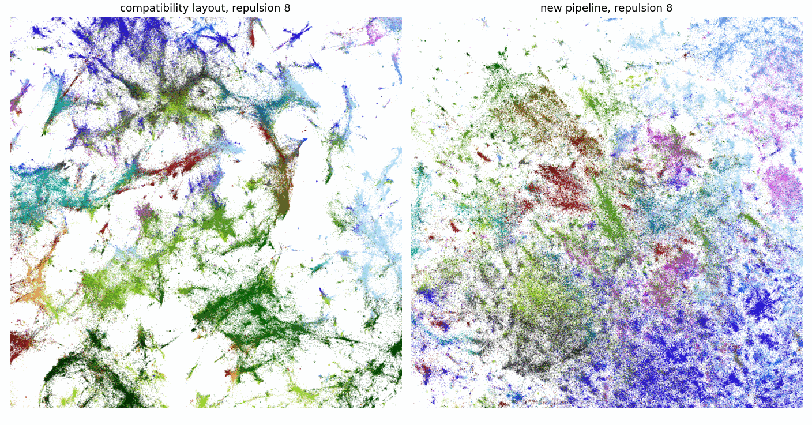
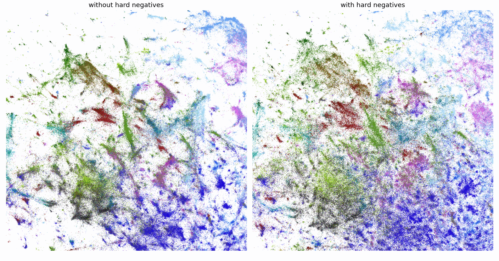
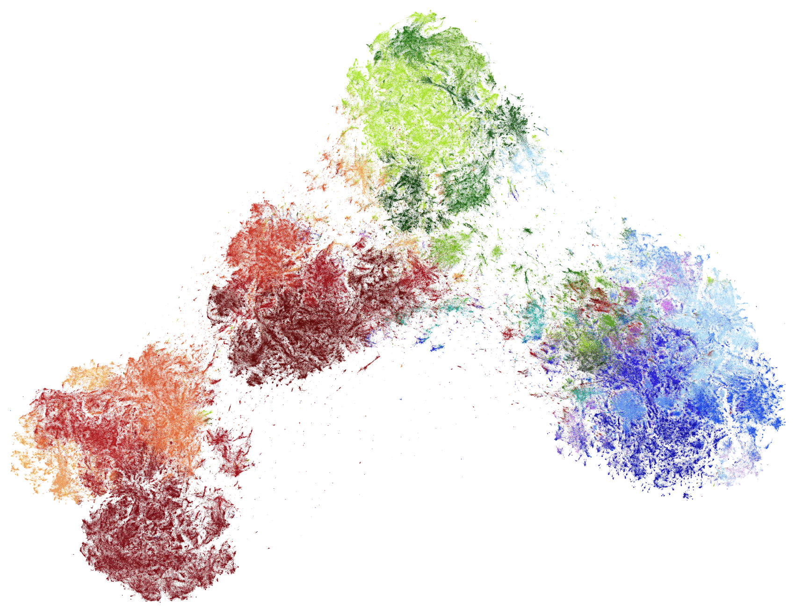

Embedding Very Large Datasets
=============================

Most of the examples in this documentation use datasets with tens of
thousands of samples, such as the 70,000 handwritten digits of MNIST.
Increasingly, however, the data that people want to explore is much
larger: every paper on arXiv, every protein in a database, or every cell
in an atlas. At the scale of millions of samples some costs that were
negligible become dominant, and some defaults that work well for small
datasets are no longer the best choice.

In this tutorial we will embed every paper on arXiv -- a little over three
million of them -- and look at the parts of UMAP that matter most at that
scale: finding nearest neighbors, initializing the embedding, the layout
optimizer, the ``repulsion_strength`` parameter, and hard negative
sampling. Along the way we will see why the new layout pipeline in UMAP
0.6 (``compatibility_layout=False``) is particularly well suited to very
large datasets.

All timings below were measured on a single machine with 64 CPU cores and
around 500GB of RAM, and are warm timings: UMAP had already been run on a small
subset of the data so that Numba compilation is not included. Your own
timings will depend on your hardware, but the relative differences should
be similar.

The data
--------

The dataset consists of the title and abstract of every paper in the
`arXiv metadata snapshot <https://www.kaggle.com/datasets/Cornell-University/arxiv>`__,
each embedded as a 4096 dimensional vector by the F2LLM-v2 8B embedding
model. Any sentence embedding model will do if you want to follow along;
smaller models produce smaller vectors and everything below will simply
run faster. We will also load the arXiv categories of each paper to color
the plots. Each paper lists one or more categories, such as ``cs.CL`` or
``hep-th``, and we will use the first of them (the primary category) and
the archive it belongs to (``cs`` or ``hep-th``).

.. code:: python3

    import numpy as np
    import pandas as pd
    import umap
    from umap.umap_ import nearest_neighbors

    data = np.load("arxiv_jun_2026_vectors_f2llm-v2-8B.npy")
    metadata = pd.read_parquet(
        "arxiv_jun_2026_full_dataframe.parquet", columns=["categories"]
    )
    primary_category = metadata.categories.str.split().str[0]
    archive = primary_category.str.split(".").str[0]
    data.shape

.. parsed-literal::

    (3080258, 4096)

That is a little over 50GB of ``float32`` vectors. The largest archives
are computer science (``cs``) with 776,261 papers and mathematics
(``math``) with 585,316, followed by condensed matter physics and
astrophysics.

For coloring the plots it helps to group the archives a little. When
arXiv was entirely physics, each area of physics was given its own
archive, so ``hep-th``, ``cond-mat`` or ``astro-ph`` sit at the same level
as all of computer science or mathematics. We will put those archives
together under physics, and color each broad domain with its own family
of hues: physics in reds and oranges, computer science in blues,
mathematics in greens, and so on. Within each domain the largest
categories get their own shade, and the rest of the domain shares one
more. A handful of papers from before 1999 use archive names that arXiv
has since retired, such as ``cmp-lg`` (now ``cs.CL``) or ``alg-geom``
(now ``math.AG``); we map those to their modern equivalents first.

Plotting millions of points
~~~~~~~~~~~~~~~~~~~~~~~~~~~

Before we start it is worth thinking about how to look at the results. A
scatter plot of three million points overplots badly: most of the plot
is a solid mass of whichever points were drawn last, and the fine
structure we are interested in is invisible. Instead we will use
`datashader <https://datashader.org>`__, which aggregates the points
falling in each pixel and then shades the pixels -- here with histogram
equalization, so that both sparse and very dense regions remain visible.
(``umap.plot.points`` switches to datashader automatically for datasets
this large, but using datashader directly makes it easy to zoom in.) To
zoom we simply give datashader a smaller range of coordinates to render;
because it renders every point at full resolution, zooming in reveals
genuine fine structure rather than just enlarging pixels.

To build the color key we need to say which categories get a shade of
their own. Here we use the categories with at least 20,000 papers that
make up at least 2% of their domain; physics is shown at the level of
its historical archives. The `glasbey <https://github.com/lmcinnes/glasbey>`__
library (``pip install glasbey``) then generates one block of related
colors for each domain.

.. code:: python3

    import datashader as ds
    import datashader.transfer_functions as tf
    import glasbey

    # Retired archive names and their modern equivalents (from arXiv's taxonomy)
    subsumed = {
        "acc-phys": "physics.acc-ph", "adap-org": "nlin.AO", "alg-geom": "math.AG",
        "ao-sci": "physics.ao-ph", "atom-ph": "physics.atom-ph",
        "bayes-an": "physics.data-an", "chao-dyn": "nlin.CD",
        "chem-ph": "physics.chem-ph", "cmp-lg": "cs.CL", "comp-gas": "nlin.CG",
        "dg-ga": "math.DG", "funct-an": "math.FA", "mtrl-th": "cond-mat.mtrl-sci",
        "patt-sol": "nlin.PS", "plasm-ph": "physics.plasm-ph", "q-alg": "math.QA",
        "solv-int": "nlin.SI", "supr-con": "cond-mat.supr-con",
    }
    # Every archive that is not listed here is part of physics
    domains = {
        "cs": "computer science", "math": "mathematics", "eess": "engineering",
        "stat": "statistics", "q-bio": "biology", "q-fin": "finance",
        "econ": "economics",
    }
    shown = {
        "physics": ["cond-mat", "astro-ph", "physics", "hep-ph", "quant-ph",
                    "hep-th", "gr-qc", "nucl-th", "math-ph"],
        "computer science": ["cs.CV", "cs.LG", "cs.CL", "cs.AI", "cs.RO",
                             "cs.IT", "cs.CR"],
        "mathematics": ["math.AP", "math.CO", "math.PR", "math.AG", "math.OC",
                        "math.NT", "math.NA"],
        "engineering": ["eess.SY", "eess.SP"],
        "statistics": ["stat.ME", "stat.ML"],
        "biology": [], "finance": [], "economics": [],
    }

    category = primary_category.replace(subsumed)
    domain = category.str.split(".").str[0].map(domains).fillna("physics")
    name = category.where(domain != "physics", category.str.split(".").str[0])

    names = [n for d, cats in shown.items() for n in cats + [f"other {d}"]]
    palette = glasbey.create_block_palette(
        [len(cats) + 1 for cats in shown.values()], optimize_palette=False
    )
    color_key = dict(zip(names, palette))
    labels = pd.Categorical(
        name.where(name.isin(names), "other " + domain), categories=names
    )

    def plot(embedding, labels=labels, color_key=color_key,
             x_range=None, y_range=None, size=1000):
        frame = pd.DataFrame(
            {"x": embedding[:, 0], "y": embedding[:, 1], "label": labels}
        )
        canvas = ds.Canvas(
            plot_width=size, plot_height=size, x_range=x_range, y_range=y_range
        )
        aggregate = canvas.points(frame, "x", "y", ds.count_cat("label"))
        image = tf.shade(aggregate, color_key=color_key, how="eq_hist", min_alpha=60)
        return tf.set_background(image, "white")

Here is the resulting color key:

All of the plots below were made with this ``plot`` function and color
key. For the zoomed views we simply set ``x_range`` and ``y_range`` to a
square around the papers we are interested in.

Finding nearest neighbors
-------------------------

The first thing UMAP does is find the nearest neighbors of every point.
For large, high dimensional datasets this is often the most expensive
step, so it is worth looking at on its own. The ``nearest_neighbors``
function does exactly what ``UMAP.fit`` does, and it accepts the same
``compatibility_layout`` option. Let's see how long the nearest neighbor
search takes with the settings UMAP 0.5 used ...

.. code:: python3

    %%time
    knn_05 = nearest_neighbors(
        data,
        n_neighbors=15,
        metric="cosine",
        metric_kwds={},
        angular=True,
        random_state=42,
        compatibility_layout=True,
    )

.. parsed-literal::

    Wall time: 6min 40s

... and with the settings used by the new pipeline:

.. code:: python3

    %%time
    knn = nearest_neighbors(
        data,
        n_neighbors=15,
        metric="cosine",
        metric_kwds={},
        angular=True,
        random_state=42,
        compatibility_layout=False,
    )

.. parsed-literal::

    Wall time: 1min 48s

That is close to four times faster. The 0.5 settings scale the number of
random projection trees with the size of the dataset, up to 64 trees for
datasets this large, and use a generous candidate list in each round of
nearest neighbor descent. The new settings use at most eight trees and
smaller candidate lists. This does cost a little accuracy: measured
against the exact nearest neighbors of a random sample of 1,000 papers,
the 0.5 settings find 99.7% of the true neighbors and the new settings
find 98.7% -- a small price for a search that is close to four times
faster.

.. note::
    For vectors of unit length, cosine distance and euclidean distance
    order neighbors identically. The embeddings here are very nearly unit
    length, and if you normalize them exactly yourself,
    ``metric="euclidean"`` is noticeably faster than ``metric="cosine"``: on this data the nearest neighbor
    search above takes 1min 21s instead of 1min 48s, with the same
    accuracy, and the complete fit at the end of this tutorial takes
    4min 22s instead of 4min 38s.

    .. code:: python3

        data /= np.linalg.norm(data, axis=1, keepdims=True)
        mapper = umap.UMAP(metric="euclidean", ...)

The rest of this tutorial compares many different layouts of the same
data. Rather than search for nearest neighbors every time, we will compute
them once and pass them to every model with the ``precomputed_knn``
parameter (see :doc:`precomputed_k-nn`). This is a good habit whenever you
are exploring parameters on a large dataset: UMAP then skips the most
expensive step entirely, and every model is built from exactly the same
graph, so any differences come from the layout alone.

Initialization
--------------

UMAP lays out its graph by starting from some initial coordinates and
then repeatedly pulling points towards their graph neighbors and pushing
them away from randomly sampled "negative" points. The optimizer moves
each point only a little at a time, and a point is only directly affected
by its graph neighbors, so information about the overall arrangement of
the data travels slowly through the graph. On three million points the
optimizer cannot fix a poor global arrangement, and the initialization
largely decides where the large-scale structure ends up.

For that reason UMAP has always defaulted to a spectral initialization,
which solves for a global arrangement of the graph directly. The catch is
that it requires an eigensolver on the whole graph, and that becomes
expensive as the graph grows. UMAP 0.6 adds a different approach,
``init="recursive"``. It repeatedly coarsens the graph by label
propagation, merging nodes into parts about a quarter of the size each
time, until the graph is small. That small graph is laid out first, and
the layout is then expanded back up one level at a time, with a short
optimization at each level. With ``verbose=True`` you can see the levels
it uses for the arXiv graph:

.. code:: python3

    mapper = umap.UMAP(
        metric="cosine",
        compatibility_layout=False,
        init="recursive",
        precomputed_knn=knn,
        random_state=42,
        verbose=True,
    ).fit(data)

.. parsed-literal::

    ...
    Recursive initialization: coarsening 3080258 nodes into about 770064 parts
    Recursive initialization: coarsening 770064 nodes into about 192516 parts
    Recursive initialization: coarsening 192516 nodes into about 48129 parts
    Recursive initialization: coarsening 48129 nodes into about 12032 parts
    Recursive initialization: coarsening 12032 nodes into about 3008 parts
    Recursive initialization: coarsening 3008 nodes into about 752 parts
    Using adam layout optimizer
    ...

To compare the initializations we will fit the same model three times,
changing only ``init``:

.. code:: python3

    embeddings = {
        init: umap.UMAP(
            metric="cosine",
            compatibility_layout=False,
            init=init,
            precomputed_knn=knn,
            random_state=42,
        ).fit_transform(data)
        for init in ("random", "spectral", "recursive")
    }

All three models use the new pipeline and the same precomputed nearest
neighbors, so the optimizer is the same and the only difference is where
it starts. Here are the resulting embeddings:

The random initialization is a failure: 200 epochs are nowhere near
enough to untangle three million randomly placed points, and every
archive is smeared across a single disc. The spectral and recursive
initializations both produce a coherent global layout, with physics on
one side, computer science on the other, and mathematics between them.
Alongside the time each initialization took, we can measure how well
separated the archives are with a silhouette score, computed on a random
sample of 10,000 papers:

.. list-table::
   :header-rows: 1

   * - ``init``
     - Initialization time
     - Silhouette by archive
   * - ``"random"``
     - under a second
     - -0.25
   * - ``"spectral"``
     - 17min 7s
     - 0.14
   * - ``"recursive"``
     - 34s
     - 0.15

Spectral and recursive initialization give layouts of similar quality,
but the spectral initialization took about thirty times as long. The
eigensolver used by the compatibility layout (the UMAP 0.5 spectral
initialization) is faster on this graph, but still took between 3min 29s
and 5min 21s in three otherwise identical runs, depending on how quickly
it converged (the newer spectral option is more robust in general,
but slower for some datasets such as this one). On some graphs the
eigensolver fails to converge at all, in which case UMAP warns and
falls back to a random initialization -- after having spent the time
trying -- and as we have just seen, at this scale a random initialization
is not a good fallback.

To see why recursive initialization works so well we can look at the
initializations themselves. Setting ``n_epochs=0`` skips the optimization
entirely, so UMAP returns the initial coordinates (centered and scaled):

.. code:: python3

    initializations = {
        init: umap.UMAP(
            metric="cosine",
            compatibility_layout=False,
            init=init,
            n_epochs=0,
            precomputed_knn=knn,
            random_state=42,
        ).fit_transform(data)
        for init in ("random", "spectral", "recursive")
    }

The random initialization is, of course, just noise. The spectral
initialization has the right global arrangement -- the archives point
out in different directions from the center -- but it is only a
skeleton: each archive is stretched out along a ray, and almost none of
the local structure is there yet. The optimizer has to build nearly all of
it. The recursive initialization, in contrast, already looks very much
like the final embedding. Measuring the initializations in the same way
as before makes the difference clear:

.. list-table::
   :header-rows: 1

   * - ``init`` (no optimization)
     - Neighbors preserved
     - Silhouette by archive
   * - ``"random"``
     - 0.0%
     - -0.05
   * - ``"spectral"``
     - 0.1%
     - 0.04
   * - ``"recursive"``
     - 3.1%
     - 0.17

Here "neighbors preserved" is measured on the same random sample of
10,000 papers: for each paper we find its 15 nearest neighbors in the
original 4096 dimensional space (exactly, by brute force), and ask what
fraction of them are also among its 15 nearest neighbors in the
embedding. We will use this measure again below. Before
any optimization the recursive initialization already preserves about
half as many neighbors as the final embedding does (6.0%), and separates
the archives at least as well. Each level of the recursion has been laid
out with a short optimization of its own, so by the time the main
optimizer starts, its job is largely one of refinement.

The layout optimizer
--------------------

The new pipeline also uses a different optimizer. The original UMAP
optimizer applies each update immediately, which makes it fast, but
means that parallel threads race with each other. With a fixed
``random_state`` it therefore has to run on a single thread to be
reproducible. On the arXiv graph, the 200 epochs of the original
optimizer take 1min 5s on all 64 cores without a seed, and 54 minutes
with ``random_state=42``.

The new Adam optimizer (``optimizer="adam"``, the default when
``compatibility_layout=False``) accumulates the forces on each point
before applying them. That makes it reproducible with a fixed seed while
still using every core. It does more work per epoch: the optimization
takes 1min 40s with hard negative sampling switched off, and 2min 18s with
it on (as it is by default for a dataset this large -- more on that
below). So it is slower than the unseeded original optimizer, but far
faster than the original optimizer can be when the results need to be
reproducible. In return it produces qualitatively better layouts, above
all because it makes larger values of ``repulsion_strength`` usable,
which we look at next.
See :doc:`optimizers` for a fuller discussion of the optimizer choices.

Turning up the repulsion
------------------------

The ``repulsion_strength`` parameter (default 1) weights the repulsive
forces from negative samples against the attractive forces along the
graph. It acts like a dial. Low repulsion lets the attractive forces
dominate, giving well separated clusters and a clear global structure,
but compressing the structure within each cluster. Turning the repulsion
up spreads points out within each region, which preserves much more of
the local neighborhood structure, at the cost of some cluster separation.

On small datasets the default is usually a good choice. On a dataset
this large, however, a lot of structure is packed into each region of the
plot, and the default compresses it heavily. Let's fit the new pipeline
with a few different repulsion strengths:

.. code:: python3

    embeddings = {
        repulsion: umap.UMAP(
            metric="cosine",
            compatibility_layout=False,
            repulsion_strength=repulsion,
            precomputed_knn=knn,
            random_state=42,
        ).fit_transform(data)
        for repulsion in (1, 2, 4, 8, 16)
    }

At the scale of the whole plot the differences are modest: the archives
stay where they were and look a little more granular. The differences are
in the fine structure, and to see them we need to zoom in. Here is the
region of the plot around the papers on optimization and control
(``math.OC``). Optimization is used everywhere, so this is a busy
crossroads of the map, where mathematics (greens), computer science
(blues), engineering (magentas), statistics (greys) and physics (reds)
all meet. Each view is centered on the ``math.OC`` papers and sized to
contain four fifths of them:

With the default repulsion the region is a dense tangle in which the
different fields blur into each other. As the repulsion increases the
region opens up, and more of the distinct groups of papers within it are
resolved. We can put numbers on this with the neighbor
preservation and silhouette measures from the previous section:

.. list-table::
   :header-rows: 1

   * - ``repulsion_strength``
     - Neighbors preserved
     - Silhouette by archive
   * - 1
     - 6.0%
     - 0.15
   * - 2
     - 7.8%
     - 0.15
   * - 4
     - 9.2%
     - 0.15
   * - 8
     - 10.6%
     - 0.15
   * - 16
     - 11.5%
     - 0.15

Neighbor preservation nearly doubles between repulsion 1 and repulsion
16, while the silhouette score changes very little: here the cost in
cluster separation is small. Only around one in
ten of the true neighbors are preserved even at the highest repulsion,
which might seem low -- but each point has 15 neighbors among three
million papers in a 4096 dimensional space, and a two dimensional plot
cannot keep all of them. What matters is that more repulsion keeps a lot
more of them.

Why doesn't everyone just turn the repulsion up? With the original
optimizer, large repulsion values tend to tear clusters apart: points are
pushed into many small fragments separated by empty space. Let's fit the
compatibility layout with repulsion 8 (without a random seed, so that it
can use every core) ...

.. code:: python3

    compatibility = umap.UMAP(
        metric="cosine",
        compatibility_layout=True,
        repulsion_strength=8,
        precomputed_knn=knn,
    ).fit_transform(data)

... and compare it with the new pipeline at the same repulsion:

If we only look at local neighborhoods the original optimizer does well
here: it preserves 12.0% of each paper's 15 nearest neighbors, against
10.6% for the new pipeline, and the two are level at a slightly larger
scale (20.5% and 20.8% of the 150 nearest neighbors). Tearing does not
create false neighbors, so these measures do not see it. You can see it
in the plot, though: the archives have broken up into a web of filaments
and fragments, and they are less well separated (a silhouette of 0.12,
against 0.15 for the new pipeline). Zooming in on the optimization and
control papers, as before, makes the problem clear:

With the original optimizer the optimization and control papers have been
scattered: to contain four fifths of them the view has to cover three
times the area that it does for the new pipeline, and what it shows is a
web of disconnected filaments and clumps separated by empty space.
Nothing in the plot tells you that those pieces belong together. The new
pipeline keeps the region together, with the different fields that meet
there laid out side by side.

The new optimizer limits the size of each repulsive force with a smooth
cap that grows with the repulsion strength (rather than clipping every
coordinate of every update at 4, as the original optimizer does), and it
balances each point's forces before moving it. Together these make the
whole range of the dial usable.

Hard negative sampling
----------------------

The repulsive force on each point is, in principle, a sum over every
other point in the dataset. UMAP estimates it with a handful of negative
samples drawn uniformly at random. Repulsion falls off quickly with
distance, though, and with three million points almost every uniformly
sampled negative is far away from the point it is meant to repel, and
pushes on it hardly at all. The nearby points, which are the ones that
determine the fine structure, are rarely sampled.

The new pipeline addresses this with hard negative sampling. Each epoch
it projects the embedding onto a random direction and sorts the points
along it. Negative samples for a point are then drawn from a window of
``negative_selection_range`` points around its own position in that
order. Geometrically, the window is a slab through the embedding that
always contains the point's nearby neighbors (plus some more distant
points along the slab), and since the direction changes every epoch, no
direction is favored. Because nearby negatives push harder, UMAP scales
the repulsion of hard negatives down to keep the overall balance of
forces, adapting the scale during the first half of the optimization.

The default ``negative_selection_range`` is 200,000. For datasets smaller
than that every point is in the window and sampling is uniform, as
before, so hard negative sampling only switches on for large datasets.
To see what it does we can compare against setting
``negative_selection_range`` to the size of the dataset, which switches it
off:

.. code:: python3

    no_hard_negatives = umap.UMAP(
        metric="cosine",
        compatibility_layout=False,
        repulsion_strength=8,
        negative_selection_range=data.shape[0],
        precomputed_knn=knn,
        random_state=42,
    ).fit_transform(data)

Here we are looking at the optimization and control region again.
Without hard negatives, the higher repulsion has separated out groups of
papers, but much of the region is still compressed into dense clumps with
empty space between them: most of the uniformly sampled negatives are far
away and contribute little to the local layout. With hard negatives the
repulsion acts where it is needed, and the region fills out into a much
more detailed structure. The neighbor preservation agrees:

.. list-table::
   :header-rows: 1

   * - ``repulsion_strength``
     - Without hard negatives
     - With hard negatives
   * - 1
     - 6.2%
     - 6.0%
   * - 2
     - 7.2%
     - 7.8%
   * - 4
     - 8.4%
     - 9.2%
   * - 8
     - 9.5%
     - 10.6%
   * - 16
     - 10.7%
     - 11.5%

At the default repulsion of 1 hard negatives make little difference, but
from repulsion 2 upwards they preserve noticeably more of the true
neighbors. The size of the window matters much less than whether
hard negatives are used at all: with repulsion 8, windows of 20,000,
50,000, 200,000 and 500,000 points preserved between 10.4% and 10.7% of the
neighbors, against 9.5% without hard negatives. The default is a
sensible choice for most datasets.

Hard negatives are not free. Projecting and sorting the embedding every
epoch, and adapting the scale of the repulsion, take time: on this
dataset the optimization takes about 2min 18s with hard negatives against
1min 40s without. That is the price of the detail you see above.

Putting it together
-------------------

Here is the whole pipeline, from the raw vectors, with the settings this
tutorial suggests for a dataset of this size: the new pipeline, which
gives recursive initialization, the Adam optimizer and hard negative
sampling by default, and a repulsion strength of 8.

.. code:: python3

    %%time
    mapper = umap.UMAP(
        metric="cosine",
        compatibility_layout=False,
        repulsion_strength=8,
        random_state=42,
    ).fit(data)

.. parsed-literal::

    Wall time: 4min 38s

For comparison, the UMAP 0.5 defaults (``compatibility_layout=True``)
take 11min 31s on the same data without a random seed, of which more
than half is the nearest neighbor search. With
``random_state=42`` the compatibility layout runs single threaded, and
the layout optimization alone takes 54 minutes.

To summarize the lessons for very large datasets:

* **Nearest neighbors** are usually the most expensive step. The new
  pipeline's settings are much faster than those of UMAP 0.5, and if you
  will fit several models to the same data, compute the neighbors once
  and pass them in with ``precomputed_knn``.
* **Initialization** decides the global structure. Spectral
  initialization becomes slow, and can fail, on graphs with millions of
  vertices; recursive initialization produces a comparable global layout
  in a fraction of the time.
* **Repulsion strength** is a dial between cluster separation and local
  fidelity. With millions of points there is a great deal of local
  structure to preserve, and values of 4 to 16 work well with the new
  optimizer.
* **Hard negative sampling** makes that repulsion count where it matters.
  It is on by default for datasets larger than 200,000 points, and adds
  around 40% to the optimization time in return for noticeably finer
  structure.
* The new optimizer is **reproducible** with a fixed ``random_state``
  while still running in parallel, which makes it practical to set a seed
  even on very large datasets.
