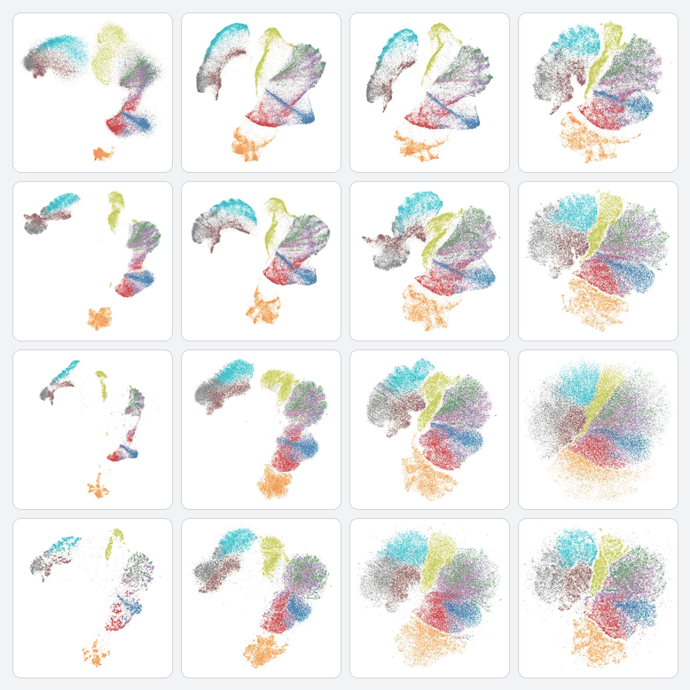

Exploring the UMAP Parameter Space
==================================

The :doc:`parameters` tutorial looks at the effects of the main UMAP
parameters one at a time. In practice, however, parameters interact, and
there are quite a few of them. It can be hard to build an intuition for
what the full range of UMAP embeddings of a dataset can look like, or to
know which parameters to reach for when trying to get a particular kind of
plot. This page provides an interactive map of the parameter space to help
with that. Rather than starting from the parameters and looking at the
resulting embedding, you can start from the kind of embedding you want and
work back to the parameters that produce it.

To build the map we ran UMAP many times over a wide range of parameter
settings, and then arranged the resulting embeddings so that embeddings
that look alike are placed near each other. The result is a zoomable
grid of tiles: each tile shows an embedding, and zooming in breaks a tile
up into the group of similar looking embeddings it stands for. Clicking
on a tile shows the parameters that produced it, along with the code
needed to reproduce it.

.. raw:: html

    <iframe src="https://lmcinnes-umap-parameter-map.static.hf.space/"
            title="UMAP parameter map"
            style="width: 100%; height: 720px; border: 1px solid #d9dee3; border-radius: 4px;"
            loading="lazy"></iframe>

The map works best with plenty of room, so you may prefer to
`open it in a page of its own <https://huggingface.co/spaces/lmcinnes/umap-parameter-map>`__.
If the interactive map does not load, the image below shows its opening
view for Fashion-MNIST.

Using the map
-------------

The map starts out showing sixteen tiles. Each of these stands for a
large group of parameter settings that give similar looking embeddings,
and shows the most representative embedding of the group. Zooming in
(with the scroll wheel, or by pinching) splits each tile into four, and
so on, until each tile is a single parameter setting. If you have a look
in mind, the idea is to zoom in towards it.

Clicking on a tile fills in the panel at the side. This lists the
parameters of the embedding shown, with any that differ from the
defaults in bold. For tiles that stand for a group of settings there is
also a small bar chart for each parameter, showing how many settings in
the group use each value. This gives a sense of which parameters matter
for that look: if every setting in the group shares the same value of a
parameter, that value is probably important; if the values are spread
across the range then that parameter has little to do with it. Finally
there is the code to reproduce the embedding shown, ready to copy.

The "Colour by" menu shades the tiles by the value of a parameter. This
is a quick way to see how a parameter is laid out across the map, and so
what kind of change it makes.

The map also has a second view. Snapping the embeddings into a grid is
convenient for browsing, but it necessarily distorts how similar the
embeddings are to each other. The "Scatter" view instead shows each
parameter setting as a point in a UMAP embedding of the embeddings
themselves -- in effect, a UMAP of UMAPs. Hovering over a point shows
its embedding, and clicking on it shows its parameters as before. This
view gives a better sense of the overall shape of the parameter space,
and of where there are large jumps between different kinds of
embedding.

Finally the "Dataset" menu switches between datasets. We have used three
quite different datasets to give a sense of how much the results depend
on the data:

* **Fashion-MNIST**: 70,000 small greyscale images of clothing in ten
  classes. This map has 16,384 parameter settings, so it has the most
  detail.
* **20 Newsgroups**: 18,170 posts from twenty newsgroups, embedded with
  the ``nomic-embed-text`` model and compared with cosine distance. The
  newsgroups are coloured by broad topic (computers, sports, politics and
  religion and so on), with related groups given related colours.
* **C. elegans embryo**: single cell RNA sequencing of 86,024 cells from
  developing C. elegans embryos (`Packer et al. 2019
  <https://doi.org/10.1126/science.aax1971>`__). As is standard for such
  data we reduced it to 50 principal components before running UMAP.
  Cells are coloured by cell type; the many cells left unannotated by the
  authors are shown in grey.

The parameters explored
-----------------------

The map covers the following parameters and values. Each embedding uses
the newer layout path (``compatibility_layout=False``) and a fixed
``random_state``, so every tile can be reproduced exactly.

=============================  =============================================
Parameter                      Values
=============================  =============================================
``n_neighbors``                5, 15, 45
``min_dist``                   0.0, 0.1, 0.2, 0.4, 0.6, 0.8
``spread``                     0.5, 0.75, 1.0, 2.0, 4.0
``repulsion_strength``         0.1, 0.33, 1.0, 3.0, 10.0, 30.0
``init_scale_factor``          0.1, 0.5, 1.0, 1.5, 2.0
``negative_selection_range``   3,000, 10,000, and the default of 200,000
``set_op_mix_ratio``           0.01, 0.1, 1.0
``densmap``                    ``False``, ``True``
=============================  =============================================

There are far too many combinations to try them all, so each map uses a
sample of them: every combination of ``n_neighbors`` and ``min_dist``,
each other parameter varied on its own, and then random combinations of
everything. A few combinations are
left out because they produce broken embeddings: a very small
``set_op_mix_ratio`` together with ``n_neighbors=5``, and DensMAP
together with a lowered ``set_op_mix_ratio``. DensMAP is also used for
only about one setting in ten, so that it does not crowd out everything
else.

The values of ``negative_selection_range`` are given for a dataset of
70,000 points, like Fashion-MNIST. Since this parameter is a number of
points, for the other datasets it is scaled in proportion to their size,
and the map shows the values actually used. For the meaning of the
parameters themselves see :doc:`parameters` for ``n_neighbors`` and
``min_dist``, and :doc:`optimizers` for ``negative_selection_range``,
``init_scale_factor`` and ``repulsion_strength``, and :doc:`densmap_demo`
for DensMAP. The remaining parameters are described in the :doc:`api`.

What the maps show
------------------

Colouring the maps by each parameter in turn shows some consistent
patterns across all three datasets.

The parameters that make the largest and most distinctive changes are
``set_op_mix_ratio``, ``negative_selection_range``,
``repulsion_strength`` and ``densmap``. Each of these takes up large
contiguous regions of the map, which means that changing it produces a
different kind of embedding, rather than a variation on the same one.
Increasing ``repulsion_strength``, for example, pulls clusters in to
tighter, more compact shapes with more space between them, while
lowering it lets them spread out into broad, filled shapes. Lowering
``set_op_mix_ratio`` towards zero makes the embedding fuzzier and more
diffuse, with clusters less clearly separated and more stray points
between them.

``n_neighbors``, ``min_dist`` and ``spread`` have more gradual effects,
and their values are more mixed together on the map. Moving through
their values tends to give a series of variations on the same embedding
rather than a different kind of embedding. ``min_dist`` and ``spread``
work together to determine how tightly points are packed, with larger
values of either giving larger, more evenly filled clusters. On
Fashion-MNIST most of the change from ``n_neighbors`` happens between 5
and 15; going up to 45 makes less difference.

``init_scale_factor`` is scattered across the maps with little visible
structure. Changing it seems to act much like changing the random seed:
it produces a different embedding, but not a different kind of
embedding. If you are not happy with an embedding, this is not usually
the parameter to change.

How the map was made
--------------------

The difficult part of building a map like this is deciding when two
embeddings "look alike". Comparing coordinates directly does not work
well, since two embeddings can look much the same while being rotated,
reflected or rearranged relative to each other. Instead we described each
embedding by a set of features: the texture and shape of the density of
points, both overall and for each class, along with statistics such as
how well the embedding keeps neighbors and classes together. Two
embeddings are then similar if their features are similar.

With a distance between every pair of embeddings we can then run UMAP
on the embeddings themselves, which gives the scatter view. To make the
zoomable grid this layout is snapped onto a square grid, and refined by
swapping tiles to keep similar embeddings as close together as possible.
Each tile at a coarser level shows whichever of the embeddings it stands
for is most typical of the group.

The thumbnails are drawn with `datashader <https://datashader.org/>`__.
One adjustment is made to them: wide empty gaps between clusters are
shortened, so that a single distant cluster does not shrink the rest of
the embedding to a speck. Since the distance between separate clusters
in a UMAP embedding carries little meaning this makes the thumbnails more
useful, but it does mean the clusters in a thumbnail may sit closer
together than they do in the embedding itself.

The code used to build the map is available in the ``parameter_map``
directory of the UMAP repository.

Caveats
-------

There are a few things to keep in mind when using the map. Each tile is a
single run with a single random seed. Some of the differences between
neighboring tiles are no larger than the differences you would see
between runs with different seeds, so it is best not to read too much
into small variations.

The map is also only as good as the measure of similarity used to build
it. It does a reasonable job of placing like with like, but it is not
perfect, and occasionally similar looking embeddings end up apart.

Finally, while the broad patterns described above held for all three
datasets, the details differ, sometimes substantially. Your own data may
behave differently again. The map is best used as a guide to which
parameters to try, and the effect of those parameters should then be
checked on the data you actually care about.
