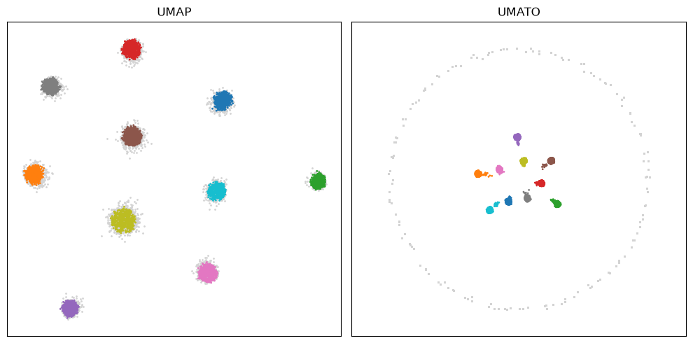
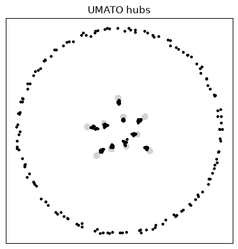
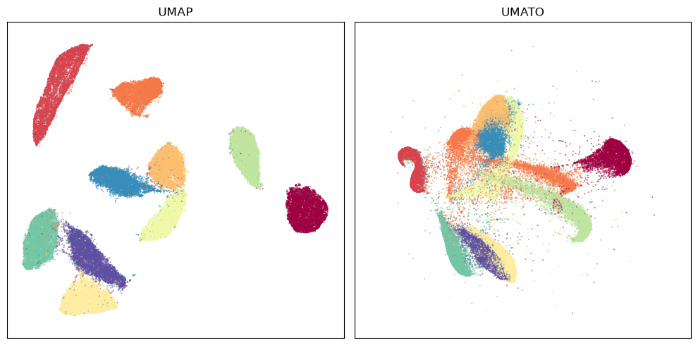

Better Preserving Global Structure with UMATO
=============================================

UMAP builds an embedding from the nearest neighbors of each point. This
makes it very good at preserving local structure, such as which points
belong together in a cluster, but it says much less about global
structure: how far apart the clusters are, or how they are arranged
relative to each other. A recent paper presented a technique called
`UMATO <https://doi.org/10.1109/TVCG.2025.3602735>`__ (Uniform Manifold
Approximation with Two-phase Optimization) that addresses this by
splitting the optimization of UMAP into two phases. UMATO first selects
a small set of representative points, called hubs, and lays them out
using the distances between all pairs of hubs, without the neighborhood
approximation that UMAP relies on. This gives a skeleton of the global
structure of the data. It then places the remaining points around the
hubs and refines their local neighborhoods much as UMAP does, while the
hubs move only slowly so that the skeleton is kept.

UMATO reuses the nearest neighbors and the fuzzy graph that UMAP
constructs, and only changes how the layout is optimized. It is
therefore available directly in this library by passing ``umato=True``
to the UMAP constructor. In this tutorial, we will compare UMATO with
UMAP on a dataset whose global structure we know, look at the hubs that
UMATO selects, try it on a real dataset, and then go over the parameters
that UMATO provides. To start, let’s load some modules.

.. code:: python3

    import matplotlib.pyplot as plt
    import numpy as np
    import sklearn.datasets
    import umap
    from scipy.spatial.distance import pdist
    from scipy.stats import spearmanr

A dataset with known global structure
-------------------------------------

To see what UMATO does differently we need data where we know what the
global structure should look like. The *Spheres* dataset consists of ten
small spheres in a 101-dimensional space, each with 500 points, all
enclosed by one large sphere of 5,000 points. Each small sphere is easy
to find from its nearest neighbors; the global structure that we would
like to see in the embedding is that the large sphere surrounds the
small ones.

.. code:: python3

    def make_spheres(
        n_inner=500, n_outer=5000, dim=101, random_state=0
    ):
        rng = np.random.default_rng(random_state)

        def sphere(n_points, radius, center):
            points = rng.normal(size=(n_points, dim))
            points /= np.linalg.norm(points, axis=1, keepdims=True)
            return center + radius * points

        centers = rng.normal(scale=10 / np.sqrt(dim), size=(10, dim))
        data = np.vstack(
            [sphere(n_inner, 5, center) for center in centers]
            + [sphere(n_outer, 25, np.zeros(dim))]
        )
        labels = np.repeat(np.arange(11), [n_inner] * 10 + [n_outer])
        return data.astype(np.float32), labels

    data, labels = make_spheres()

We will plot many embeddings of this data, so let’s write a small
function for it. The points of the large sphere are drawn first in light
gray, and the ten small spheres on top of them in color.

.. code:: python3

    def plot_spheres(embedding, title, ax):
        outer = labels == 10
        ax.scatter(
            *embedding[outer].T, c="lightgray", s=1, rasterized=True
        )
        ax.scatter(
            *embedding[~outer].T,
            c=labels[~outer],
            cmap="tab10",
            s=1,
            rasterized=True,
        )
        ax.set_title(title)
        ax.set_xticks([])
        ax.set_yticks([])
        ax.set_aspect("equal", adjustable="datalim")

Before we try out UMATO let’s run standard UMAP so we have a baseline to
compare to.

.. code:: python3

    mapper = umap.UMAP(random_state=42).fit(data)

Now let’s try UMATO instead. In practice this is as easy as adding the
parameter ``umato=True`` to the UMAP constructor.

.. code:: python3

    umato_mapper = umap.UMAP(umato=True, random_state=42).fit(data)

Now let’s see what sort of results we get:

.. code:: python3

    fig, axes = plt.subplots(1, 2, figsize=(10, 5))
    plot_spheres(mapper.embedding_, "UMAP", axes[0])
    plot_spheres(umato_mapper.embedding_, "UMATO", axes[1])
    plt.tight_layout()
    plt.show()

You can see a significantly different result. UMAP finds the ten small
spheres, but the large sphere has disappeared: its points have been
split up and spread as a thin gray halo around each of the small
spheres. This is because UMAP only sees the nearest neighbors of each
point, and in 101 dimensions the nearest neighbors of the points on the
large sphere are all points of the small spheres. The fact that the
large sphere encloses everything else is a global property that the
neighborhoods alone do not capture.

UMATO, on the other hand, keeps the large sphere around the small ones,
which is exactly the global structure that we built into the data. The
small spheres themselves are still compact and well separated. Note that
the large sphere is drawn as a thin ring of small clumps rather than as
a spread of points; we will see why when we look at the hubs below.

Measuring global structure
--------------------------

Pictures are a good start, but we can also measure how well global
structure is preserved. We will use two simple measures. The first takes
the centroid of each group, both in the input data and in the embedding,
and computes the Spearman rank correlation between the pairwise
distances of those centroids; it tells us how well the arrangement of
the groups is preserved. The second computes the same correlation
between the pairwise distances of a random sample of the points
themselves. For both measures a value of 1 means that the order of the
distances is preserved exactly.

.. code:: python3

    def centroid_correlation(data, embedding, labels):
        groups = np.unique(labels)
        data_centroids = [
            data[labels == group].mean(axis=0) for group in groups
        ]
        embedding_centroids = [
            embedding[labels == group].mean(axis=0) for group in groups
        ]
        return spearmanr(
            pdist(data_centroids), pdist(embedding_centroids)
        ).statistic

    def distance_correlation(
        data, embedding, n_samples=2000, random_state=0
    ):
        rng = np.random.default_rng(random_state)
        sample = rng.choice(data.shape[0], n_samples, replace=False)
        return spearmanr(
            pdist(data[sample]), pdist(embedding[sample])
        ).statistic

    def report(data, labels, models):
        print("        centroids  points")
        for name, model in models.items():
            centroids = centroid_correlation(
                data, model.embedding_, labels
            )
            points = distance_correlation(data, model.embedding_)
            print(f"{name:6}  {centroids:9.3f}  {points:6.3f}")

    report(data, labels, {"UMAP": mapper, "UMATO": umato_mapper})

.. parsed-literal::

            centroids  points
    UMAP        0.493   0.031
    UMATO       0.647   0.600

UMATO does better on both measures. The difference is most striking for
the distances between individual points: UMAP preserves almost none of
their order, since it has broken the large sphere apart, while UMATO
keeps most of it. These are only simple measures of global structure,
and the values depend on the data, but they give a useful way to check
how far the global structure of an embedding can be trusted.

Looking at the hubs
-------------------

After fitting, a UMATO model records which points were used as hubs in
``umato_hubs_``, and the role that every point played in
``umato_hub_info_``. A value of 2 marks a hub. A value of 1 marks a
point that is reached from the hubs by following nearest-neighbor
relationships; these points start close to their nearest hubs and are
refined in the local phase. A value of 0 marks an outlier: a point that
none of those points lists as one of its nearest neighbors. Outliers
take no part in the optimization and are placed at the end, next to
points that are close to them in the input data.

.. code:: python3

    np.bincount(umato_mapper.umato_hub_info_, minlength=3)

.. parsed-literal::

    array([4853, 4852,  295])

Here almost half of the points are outliers. As we saw above, the
nearest neighbors of the points on the large sphere are points of the
small spheres, so no point lists a point of the large sphere as one of
its nearest neighbors. Apart from the hubs, the whole large sphere is
therefore made of outliers. UMATO places each outlier next to the
embedded points of its own group of nearby points, which here is just
the hub of that group, so the points of the large sphere end up in small
clumps on their hubs. Let’s now plot the hubs on top of the embedding.

.. code:: python3

    hubs = umato_mapper.umato_hubs_
    embedding = umato_mapper.embedding_

    fig, ax = plt.subplots(figsize=(5, 5))
    ax.scatter(*embedding.T, c="lightgray", s=1, rasterized=True)
    ax.scatter(*embedding[hubs].T, c="black", s=6)
    ax.set_title("UMATO hubs")
    ax.set_xticks([])
    ax.set_yticks([])
    ax.set_aspect("equal", adjustable="datalim")
    plt.show()

The hubs form the skeleton of the embedding. Since the large sphere
holds half of the points, half of the hubs lie on it and trace the ring
around the small spheres, while each small sphere is represented by
about fifteen hubs of its own. The local phase then fills in the
neighborhoods around this skeleton without changing its overall shape.

A real dataset
--------------

The Spheres dataset was built to have a clear global structure, so let’s
now try UMATO on real data. We will use the MNIST dataset of 70,000
gray-scale images of hand-written digits, which should be familiar from
earlier tutorial sections, and compare UMAP and UMATO as before.

.. code:: python3

    mnist = sklearn.datasets.fetch_openml(
        "mnist_784", version=1, as_frame=False
    )
    mnist_data = np.ascontiguousarray(mnist.data, dtype=np.float32)
    mnist_labels = np.asarray(mnist.target, dtype=np.int32)

.. code:: python3

    mnist_mapper = umap.UMAP(random_state=42).fit(mnist_data)

.. code:: python3

    mnist_umato_mapper = umap.UMAP(umato=True, random_state=42).fit(
        mnist_data
    )

.. code:: python3

    fig, axes = plt.subplots(1, 2, figsize=(10, 5))
    for model, title, ax in zip(
        [mnist_mapper, mnist_umato_mapper], ["UMAP", "UMATO"], axes
    ):
        ax.scatter(
            *model.embedding_.T,
            c=mnist_labels,
            cmap="Spectral",
            s=0.1,
            rasterized=True,
        )
        ax.set_title(title)
        ax.set_xticks([])
        ax.set_yticks([])
        ax.set_aspect("equal", adjustable="datalim")
    plt.tight_layout()
    plt.show()

.. code:: python3

    report(
        mnist_data,
        mnist_labels,
        {"UMAP": mnist_mapper, "UMATO": mnist_umato_mapper},
    )

.. parsed-literal::

            centroids  points
    UMAP        0.744   0.304
    UMATO       0.746   0.443

UMAP gives compact and clearly separated clusters, while UMATO places
the clusters closer together, with more points spread between them. Both
embeddings keep the same broad groupings, such as the 4, 7 and 9
clusters lying next to each other, and the arrangement of the cluster
centroids is preserved about equally well. The distances between
individual points, however, are preserved noticeably better by UMATO.

This illustrates the trade-off between the two methods. UMATO spends
part of its effort on the global skeleton and only a short local phase
on the neighborhoods, so its clusters are less crisp than UMAP’s. If you
mainly want to find clusters, UMAP remains a great choice; if you want
to see how the clusters relate to each other, or how far apart the
points are, UMATO is worth trying.

Parameters for UMATO
--------------------

UMATO inherits the parameters of UMAP that build the nearest neighbor
graph, such as ``n_neighbors`` and ``metric``, and uses them in the same
way. A few parameters have a UMATO-specific meaning:

- ``umato_n_hubs``: the target number of hubs. By default UMATO uses a
  third of the points, up to 300. More hubs give a finer skeleton, but
  the global phase uses every pair of hubs, so its cost grows
  quadratically with the number of hubs.
- ``umato_global_epochs``: the number of epochs of the global phase that
  lays out the hubs. The default is 100.

and UMATO adds two parameters of its own:

- ``n_epochs``: with UMATO this is the number of epochs of the local
  phase. The default is 50.
- ``init``: the initial layout of the hubs. The default, ``"auto"``,
  uses PCA of the hubs; ``"random"``, ``"spectral"`` or an array of
  initial coordinates can also be given.
- ``learning_rate`` and ``repulsion_strength``: these scale the learning
  rate and the repulsion of the local phase. The default of 1.0 for both
  matches the original UMATO implementation.
- ``optimizer``: by default the local phase uses the update of the
  original UMATO implementation. Passing ``optimizer="adam"`` or
  ``optimizer="momentum"`` uses that UMAP optimizer instead (see
  :doc:`optimizers`), still with the hubs moving more slowly than the
  other points.

Limitations
-----------

UMATO lays out the data that it is fitted on, and some features of UMAP
are not available with it. Calling ``transform``, ``inverse_transform``
or ``update`` on a UMATO model raises an error, so new data cannot be
added to an existing UMATO embedding. UMATO cannot be combined with
supervised dimension reduction or with DensMAP, and it requires the
default Euclidean ``output_metric``. If you need these features, or if
the arrangement of clusters is not important for your analysis, standard
UMAP is the better choice.
