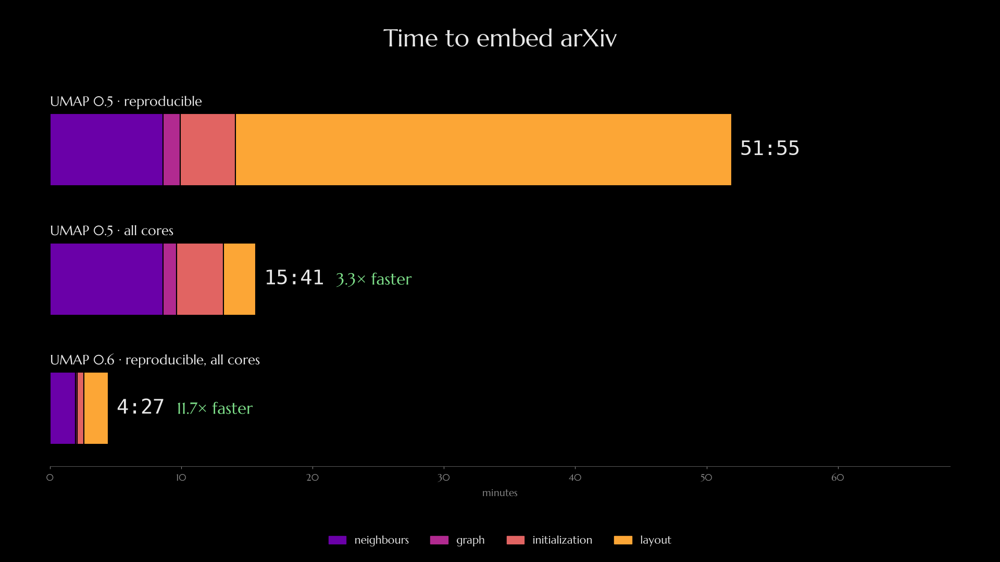
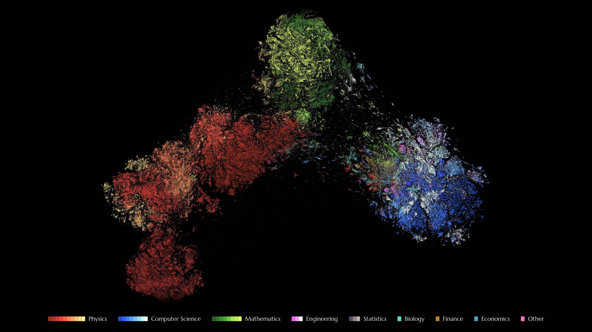
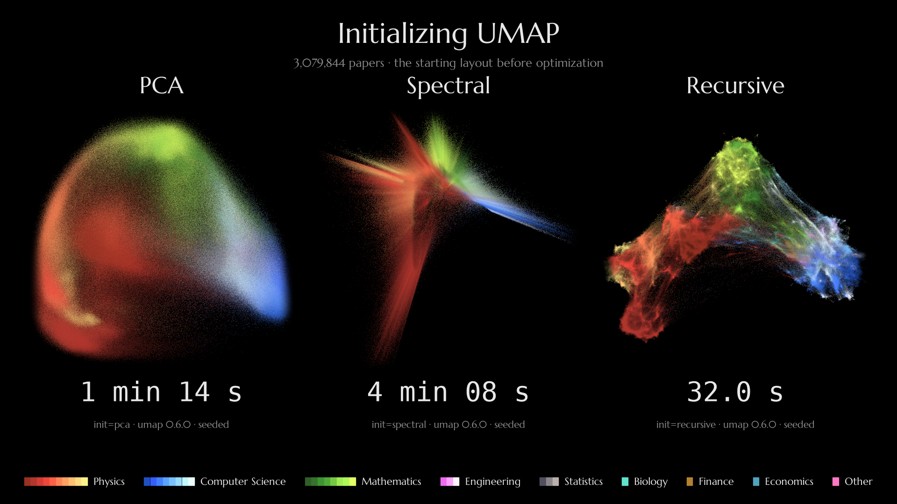

What's new in UMAP 0.6
======================

UMAP 0.6 brings some major improvements over earlier versions. A new initialization, new optimizers 
and faster nearest neighbour search make UMAP much faster and far better at large scale. 
For example, on 3 million arXiv papers it finishes in under 5 minutes, before UMAP 0.5 has even
found its nearest neighbours.

We can see this in action in the video below. We are working with F2LLM-v2-8B based embeddings
of over 3 million arXiv paper titles and abstracts. That means we have over 3 million
vectors each existing in a 4096-dimensional space. Both versions of UMAP were run
and the animations are synced based on wall-clock time for each run.

.. raw:: html

    

      <iframe src="https://www.youtube-nocookie.com/embed/l1oZREHTvuY"
              title="Racing UMAP 0.5 and UMAP 0.6"
              style="position: absolute; top: 0; left: 0; width: 100%; height: 100%;"
              frameborder="0" allowfullscreen
              allow="accelerometer; clipboard-write; encrypted-media; gyroscope; picture-in-picture"></iframe>
    

This represents a dramatic improvement both in the speed of generation, but also in the quality of the output.
For large-scale datasets, this improvement is particularly significant, allowing UMAP to now scale well into
the millions of sample range, and still find and resolve detailed fine-grained structure.

The new pipeline is currently opt-in, as it changes the output significantly.

.. code:: python3

    import umap

    reducer = umap.UMAP(compatibility_layout=False)
    embedding = reducer.fit_transform(data)

It is anticipated that this will be the default in future versions of UMAP, but for now you will need
to explicitly enable it, and the default UMAP will continue to produce output consistent with the old 
versions.

Speed
-----

Let's start by looking at how the new UMAP 0.6 pipeline improves performance:

* Neighbour search is ~4x faster by making better use of PyNNDescent.
* Graph construction has been made significantly more efficient.
* Initialization is faster with a new init method.
* Using the new optimizers, the whole run is reproducible with a fixed seed
  while using every core. A seeded 0.5 run is single-threaded: 52 minutes,
  12x longer.

Much of the nearest neighbour search performance comes from a more carefully tuned
use of the latest PyNNDescent library. The new settings trade a small amount of kNN-graph
accuracy for vastly improved run times. And while the exact kNN recall has descreased 
marginally, the misses are with other very nearby points, so the practical effects on
the output are even more negligible.

The graph construction phase, which was a small portion of the time already, underwent
a number of small optimizations that brought it down much further.

The new initialization method, which we will discuss in more detail below, offers a significant
performance improvement over the previous default spectral embedding, particularly for very
large datasets. The spectral initialization is very sensitive to certain graph properties,
which can cause it to take a very long amount of time, or even fail completely. These issues
are most apparent in large datasets, but they can occur even in moderately sized datasets.

Most importantly, the new optimizers provide better optimization quality at around the same runtime
as the previous version, but most importantly they are now fully reproducible while using all
available cores. This is a significant improvement over the previous version, which was 
restricted to being single threaded when ensuring reproducible results.

Quality
-------

Just as important as how quickly we get a result is the quality of the
result. UMAP 0.6 works far better on million-scale datasets thanks to a new,
better initialization and significant improvements in the optimizer. The
result resolves finer cluster structure in fewer epochs.

It is worth comparing the increased detail and fidelity provided by the new
UMAP 0.6 optimizers. They resolve structure at much finer scales, and can
significantly improve on the neighbourhood accuracy of UMAP 0.5 despite being
faster.

.. raw:: html

    

      <iframe src="https://www.youtube-nocookie.com/embed/xgP0FnDPcaI"
              title="A Comparison Tour of arXiv embeddings for UMAP version 0.5 and 0.6"
              style="position: absolute; top: 0; left: 0; width: 100%; height: 100%;"
              frameborder="0" allowfullscreen
              allow="accelerometer; clipboard-write; encrypted-media; gyroscope; picture-in-picture"></iframe>
    

While specific figures on neighboruhood preservation on some example papers, as seen in the video, are a useful
quantitative guide, the real comparison is the qualitative visual fidelity of the embeddings -- the more fine-grained
and detailed sub-cluster structure that you can observe in the 0.6 version.

Recursive initialization
------------------------

A large part of the overall improvement comes from a brand-new initialization
scheme. The new recursive initialization works by initializing UMAP using UMAP
itself -- laying out a coarse version of the graph structure, and then
refining, in a recursive tower of initializations.

.. raw:: html

    

      <iframe src="https://www.youtube-nocookie.com/embed/vjMx9yzPhKs"
              title="Recursive initialization for UMAP"
              style="position: absolute; top: 0; left: 0; width: 100%; height: 100%;"
              frameborder="0" allowfullscreen
              allow="accelerometer; clipboard-write; encrypted-media; gyroscope; picture-in-picture"></iframe>
    

The new recursive initialization provides a far better starting point, much
closer to UMAP's final result than the messy blurs provided by spectral
initialization or PCA, and it does so faster than either!

This results in a starting point that allows UMAP's optimizer to settle (to
within 1% of the final layout) in far fewer epochs than older initialization
approaches.

.. raw:: html

    

      <iframe src="https://www.youtube-nocookie.com/embed/52tLDhgeF7I"
              title="Racing different initialization methods for UMAP"
              style="position: absolute; top: 0; left: 0; width: 100%; height: 100%;"
              frameborder="0" allowfullscreen
              allow="accelerometer; clipboard-write; encrypted-media; gyroscope; picture-in-picture"></iframe>
    

New optimizers
--------------

Most of that gain in fidelity at scale comes from a very efficient form of
hard-negative mining, which makes negative sampling far more effective on very
large datasets, together with better handling of high repulsion strengths.

.. raw:: html

    

      <iframe src="https://www.youtube-nocookie.com/embed/EHd-vBwonxo"
              title="Hard-negative-mining in UMAP 0.6"
              style="position: absolute; top: 0; left: 0; width: 100%; height: 100%;"
              frameborder="0" allowfullscreen
              allow="accelerometer; clipboard-write; encrypted-media; gyroscope; picture-in-picture"></iframe>
    

Here a "hard-negative" is a negative sample that is nearby to the current point in the current embedding.
Since repulsive forces decay with distance, the many distant samples provided by uniform sampling end
up contributing very little and much computational cost. This is particularly true for very large datasets,
where almost all points are relatively far from any particular query point.

To remedy this, the new UMAP optimizers implement hard-negative mining, which performs an inexpensive
approximation to importance sampling, biasing the sampling strategy toward nearby negative samples. To
make up for the bias, the forces are appropriately scaled to ensure unbiased estimation of the repulsive interactions.

Speaking of repulsive forces, UMAP was originally designed around a small portion of the
`attraction-repulsion spectrum <https://www.jmlr.org/papers/v23/21-0055.html>`_.
The new UMAP 0.6 optimizers lift these restrictions, allowing UMAP to perform
well for much higher repulsion strengths, providing better kNN recall.

.. raw:: html

    

      <iframe src="https://www.youtube-nocookie.com/embed/JqhJofvpaKM"
              title="The repulsion dial for UMAP 0.6"
              style="position: absolute; top: 0; left: 0; width: 100%; height: 100%;"
              frameborder="0" allowfullscreen
              allow="accelerometer; clipboard-write; encrypted-media; gyroscope; picture-in-picture"></iframe>
    

The relevant dial here is the ``repulsion_strength`` parameter, which controls the magnitude of the 
repulsive forces in the embedding. While the 0.5 version supported only small values, the new
0.6 optimizers are much more robust and can handle repulsion strengths into the hundreds.

Trying it out
-------------

Currently the new optimizers and initialization are opt-in as they change the
output: set ``compatibility_layout=False``. Future versions will make them the
default, so try them now!

* Documentation on the new optimizers: :doc:`optimizers`
* Handling large, million-scale datasets: :doc:`large_datasets`
* Reproducibility and the compatibility layout: :doc:`reproducibility`

Other changes and bug fixes
---------------------------

* Migration and defaults. ``compatibility_layout`` now defaults to ``None``:
  it uses the 0.5.x pipeline but emits a ``FutureWarning``. Users should be
  told to set ``True`` to keep current behaviour and silence the warning, or
  ``False`` to switch.
* Reproducible *and* parallel results also apply to ``transform`` and to
  DensMAP, which can now be combined with the Adam or momentum optimizers.
* Optional RINND nearest-neighbour backend
  (``pip install umap-learn[rinnd]``, ``nearest_neighbor_backend``).
* New initialization scaling controls: ``init_rescale`` and ``init_scale_factor``.
* ``inverse_transform``: vectorized Delaunay adjacency (~2700x faster, 50%
  less RAM), dimension validation, and a warning plus nearest-point
  extrapolation for queries outside the convex hull.
* A broad set of performance and memory improvements (argpartition-based kNN
  selection, faster BFS and component layout, vectorized DensMAP density,
  faster AlignedUMAP relation handling, lower peak memory in fit/transform,
  no data copy when ``unique=False``).
* ``plot.show()`` can display interactive plots with search.
* Input dtype is preserved in ``transform`` / ``fit_transform`` output;
  a ``py.typed`` marker is bundled.
* Notable bug fixes: NaN embeddings from fast-math layout optimization;
  NaN gradients in ParametricUMAP under XLA;
  combined models without DensMAP no longer fail with ``KeyError``;
  ``update()`` initialises new points from the same neighbours as the graph; 
  plus fixes to ``smooth_knn_dist``, spectral init on tiny graphs,
  sparse ``transform``, Gaussian energy / symmetric KL / Hellinger metrics,
  and AlignedUMAP ``n_epochs`` handling. See :doc:`release_notes`.
* Requirements have changed: NumPy 2.0+, SciPy 1.13+, Numba 0.60+, PyNNDescent 0.7+;
  Python 3.10 to 3.14 (no TensorFlow/ParametricUMAP or RINND wheels on 3.14
  yet).

Thanks to all the contributors who provided features and bug fixes for this
release. Thank you also to all the people who have reached out with comments,
suggestions, and feature requests. This would not have been possible without
your help.
